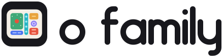

<p align="center">
  <picture>
    <source media="(prefers-color-scheme: dark)" srcset="assets/logo-dark.svg">
    
  </picture>
  <br>
  <a href="LICENSE"></a>
</p>

<p align="center">The o family: Go tools and libraries for a terminal workspace of agents, built from declared data.</p>

The names are Japanese food and craft words, most with the honorific お (o-): ochazuke (tea over rice), oden (a hotpot of skewered ingredients), matomeru (to gather, as a furoshiki bundles), nabe (a hotpot). The `o` root bin runs every `o-*` tool on PATH: `o proj`, `o ai`, `o inv`.

## Members

| | Repository | What it is |
| --- | --- | --- |
|  | [ochazuke](https://github.com/unixsuperhero/ochazuke) | A Go TUI framework on Bubble Tea v2 where nouns, verbs and keybindings are data, so every action in an app is also a command you can run from the shell. |
|  | [oden](https://github.com/unixsuperhero/oden) | The lowest layer for subcommand CLIs in Go: a bin's inline commands merged with executables on PATH, resolved by prefix. Standard library only. |
|  | [matomeru](https://github.com/unixsuperhero/matomeru) (`mtm`) | A terminal workspace for coding agents: projects, tasks, notes, live agent panes, their turns and your reviews, in one TUI. |
|  | [nabe](https://github.com/unixsuperhero/nabe) | A host for ochazuke extensions (`o nabe`, `o tui`): any executable that answers `catalog` becomes a page. |
|  | [o-ai](https://github.com/unixsuperhero/o-ai) | The local AI harnesses and their providers, models, skills, agents and settings, inspected without making a model request. |
|  | [o-inventory](https://github.com/unixsuperhero/o-inventory) | Snapshots the family's tools, nouns, verbs and bindings over time and renders the changelogs from the diffs. |
|  | [o-proj](https://github.com/unixsuperhero/o-proj) | The family's repositories on disk: create, record in one manifest, link from the hub, clone, sync and report status. |
|  | [o-md](https://github.com/unixsuperhero/o-md) | Markdown documents with item notes, a family extension for mtm. |
|  | [o-qbt](https://github.com/unixsuperhero/o-qbt) | qBittorrent on the NAS: torrents and categories as rows, transfer limits, and a free-space guard. |
|  | [o-modal](https://github.com/unixsuperhero/o-modal) | A proof of concept: a modal key engine for Go. Keys in, steps out; the host decides what runs. |

Tools without a logo of their own carry the family's.

## How they fit

```
libraries   oden ─────────────► ochazuke
            CLI dispatch:        nouns, verbs, bindings, modes,
            names on PATH        lists, palette, the CLI shell
                 │                    │
hosts       mtm (matomeru)       nabe (o tui)
            the agent workspace  a page per extension
                 │                    │
                 └──────┬─────────────┘
extensions   o-ai  o-inventory  o-proj  o-md  o-qbt  ...
             each an o-* bin that answers `catalog`
```

- **Libraries.** oden resolves a command name to an inline handler or an executable on PATH, so commands are just names and a tool composes them. ochazuke builds on oden: an app declares its nouns, verbs and bindings as data, and the same declarations drive the TUI, the palette and the command line.
- **Hosts.** matomeru (`mtm`) and nabe are ochazuke apps that mount other tools. `mtm <sub>` and `o <sub>` find `mtm-<sub>` and `o-<sub>` bins on PATH.
- **Extensions.** Every `o-*` tool answers `BIN catalog` with the JSON `ochazuke/cli.Catalog` writes; a host reads it and shows the tool's nouns as pages, its verbs as keys and palette commands. o-inventory reads the same catalogs to snapshot the whole family.

Plans, todos and the roadmap for the family live outside these repositories, in the hub's `o-plans`.

## The `o family` command (moved)

This repository used to hold the family's repository status report. It moved into **o proj** (github.com/unixsuperhero/o-proj, `~/proj/o-proj`): `o proj status [DIR...] [-d|--dirty] [-c|--clean] [-j|--json]`, over the repositories in o proj's manifest (`~/hub/repos.json`).

`o family` still works: it prints one deprecation line on stderr and runs `o proj status` with the same arguments (`o family repos` runs `o proj status --json`), with o-proj's exit code. The old `-r/--repos` and `-u/--hub` flags are gone; discovery is the manifest. It also answers `catalog` (schema 1, no nouns), so family tooling still reads it.

```sh
gofmt -l . && go vet ./... && go test -race ./...
go build -o ~/bin/o-family .
```

## Logo and demo

The logo is an ekiben, a bento box with compartments of different shapes and sizes: rice with an umeboshi, a wide strip, a tall pickle slot, a square of tamagoyaki, a round cup and a side. Each compartment is one member's hue (ochazuke green, o-ai indigo, o-proj teal, oden amber, matomeru violet, o-inventory vermilion) on a neutral ink tile, so no single tool owns the family mark. `python3 docs/logo/build.py` writes `assets/icon.svg`, `assets/logo-light.svg` and `assets/logo-dark.svg`, with the wordmark drawn in the family's lettering (ochazuke's and matomeru's; `--check` confirms the glyphs still redraw theirs; `--preview DIR` renders 16, 32 and 128 px PNGs and the 1-colour icon). [animation-o-family-overview.html](animation-o-family-overview.html) is an animated overview of the family; open it in a browser.

**[Watch: declared as data](https://unixsuperhero.github.io/o-family/animations/declarative/)**, a ten-minute tour of the family (oden, ochazuke, matomeru, the extensions, o-story) with real recordings, built with the `/animate` template. Its source is [`animations/declarative/`](animations/declarative/); `c` opens the chapter picker.

MIT license.
